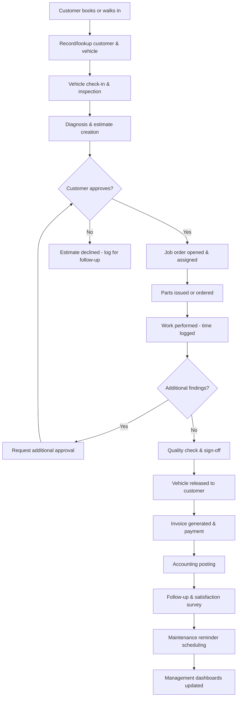
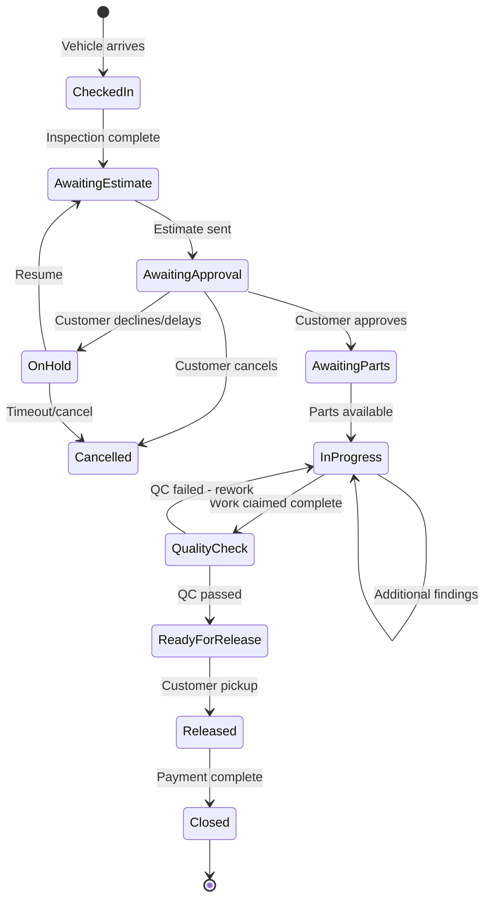
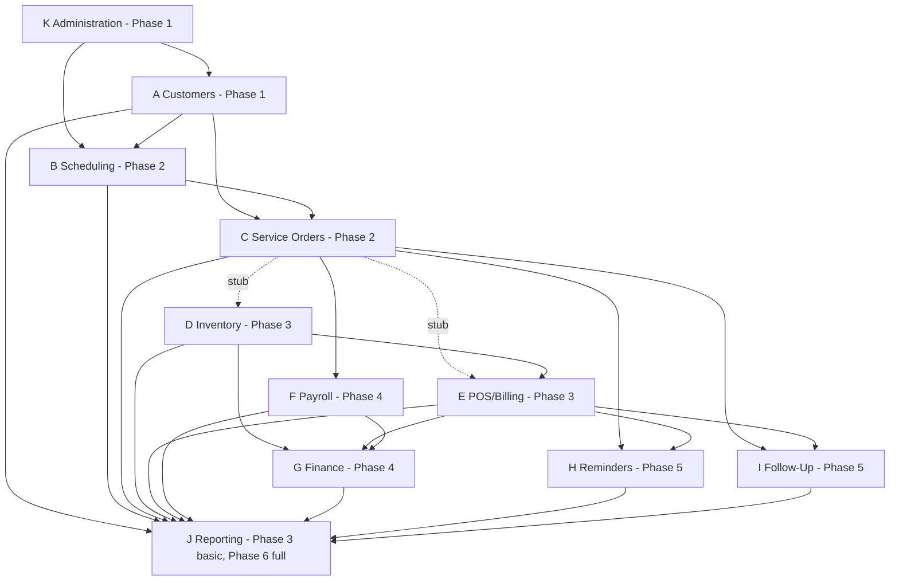

# AMS Master Plan v1.0

**Project:** Autoshop Management System for JRS Bongabon  
**Source:** Autoshop-Management-System-Master-Plan.docx v1.0 (Blueprint)  
**Status:** Draft for Gate 0 Approval  
**Last Updated:** 2026-11-10

---

## Document Control

This Master Plan is the team's living specification derived from the Blueprint. After Gate 0 approval, the Blueprint remains frozen as the original reference, and this document becomes the authoritative source for development decisions.

**Change Control:** Any deviation requires a Change Request (CR-nn) documented in `docs/DECISIONS.md` with impact analysis and approval before implementation.

**Fidelity Note:** This Master Plan faithfully carries over all Blueprint content. Items marked `[CLARIFICATION]` are expansions or interpretations submitted for Gate 0 review. Items marked `PENDING(Q-nn)` reference open questions in `docs/OPEN-QUESTIONS.md`.

---

## 1. Vision, Purpose, and Scope

### Vision (§1)

The Autoshop Management System (AMS) is a single integrated platform that runs the entire JRS Bongabon autoshop from customer booking through repair completion to follow-up and back-office operations. It eliminates paper job cards, notebooks, and spreadsheets, providing one source of truth for every vehicle, job, part, and peso.

### Goals (§1)

- Remove paper job cards, notebooks, and spreadsheets; establish one source of truth
- Shorten vehicle turnaround time and reduce idle bay time  
- Eliminate stock-outs and unrecorded part usage (shrinkage)
- Increase repeat business through automated maintenance reminders and follow-ups
- Provide the owner real-time visibility into revenue, profit, technician productivity, and cash position
- Create a full, auditable service history for every vehicle

### Success Measures — KPIs (§1)

| KPI | Target | Measurement Method |
|-----|--------|-------------------|
| Average job turnaround time | TBD `PENDING(Q-01)` | Check-in to release timestamp |
| Bay and technician utilization rate | TBD `PENDING(Q-01)` | Occupied hours / available hours |
| No-show rate | TBD `PENDING(Q-01)` | No-shows / total appointments |
| Inventory accuracy | TBD `PENDING(Q-01)` | Count variance / total value |
| Stock-out incidents | TBD `PENDING(Q-01)` | Blocked jobs per month |
| Gross margin per job | TBD `PENDING(Q-01)` | (Revenue - COGS) / Revenue |
| Gross margin by service type | TBD `PENDING(Q-01)` | Segmented by service category |
| Gross margin per technician | TBD `PENDING(Q-01)` | Attributed by completion |
| Repeat-customer rate | TBD `PENDING(Q-01)` | Return visits / total customers |
| Reminder-to-booking conversion | TBD `PENDING(Q-01)` | Bookings from reminders / reminders sent |
| Customer satisfaction score (CSAT) | TBD `PENDING(Q-01)` | Post-service survey average |
| Days to collect on credit | TBD `PENDING(Q-01)` | Invoice date to payment date |

`PENDING(Q-01):` Owner to set baseline and target values for each KPI.

### In Scope — Always

- All modules A–K as specified in §5
- All phases 0–7 as specified in §11
- Web application (desktop, tablet, mobile-friendly)
- Single-branch operation with multi-branch data readiness
- Philippine business context (PHP currency, Asia/Manila timezone, statutory rules)
- English language UI (bilingual readiness `PENDING(Q-02)`)
- Security baseline (§I): authentication, RBAC, audit, encryption, backups
- Integrations: SMS, email, payment channels, printers, scanners `PENDING(Q-03)` for vendor selection
- Customer portal `PENDING(Q-04)` — scope confirmation required
- All documents specified in §J
- Contract draft (§J)
- Vulnerability assessment (Phase 7, per Blueprint closing note)

### Out of Scope — Never (unless approved via Change Request)

- Future enhancements listed in §14 unless explicitly moved into scope
- Multi-branch consolidated operations (data structure ready, UI deferred)
- Customer mobile app (Android or iOS) — `PENDING(Q-05)` if §14 note means include now
- Online parts e-commerce with supplier APIs
- Telematics / OBD-II predictive maintenance — `PENDING(Q-06)` research vs. integration
- Custom hardware beyond standard receipt printers, scanners, cash drawer, attendance device
- Integration with external accounting software beyond export (import is out of scope)
- Languages other than English `PENDING(Q-02)` and optionally Filipino

---

## 2. Users, Roles, and Access Control

### User Roles and Responsibilities (§2)

| Role | Main Responsibilities | Primary Modules Used |
|------|----------------------|---------------------|
| Owner / General Manager | Oversight, approvals, finance, strategy | J, G, F, K, all (view) |
| Service Advisor / Front Desk | Customer intake, appointments, estimates, communication | A, B, C, I |
| Cashier | Billing, payments, receipts, end-of-day cash reconciliation | E |
| Technician / Mechanic | Execute jobs, log work, request parts | C (job view), D (request) |
| Shop Supervisor / Foreman | Assign jobs, quality check, approve releases | C, B, J |
| Parts / Inventory Clerk | Receiving, stock counts, issuance, purchasing | D |
| HR / Payroll Officer | Attendance, payroll, deductions | F |
| Accountant / Bookkeeper | Expenses, reconciliation, financial reports | G, E, J |
| System Administrator | Users, permissions, settings, backups | K |
| Customer (optional portal) | Book, view history, approve estimates, pay | A, B, H, I `PENDING(Q-04)` |

`[CLARIFICATION]:` Added "Shop Supervisor / Foreman" and "Customer" from §2 which are missing from the §8 RBAC matrix. These roles need permission definitions.

### Role-Based Access Control Matrix (§8)

| Module | Owner/GM | Advisor | Cashier | Tech | Parts | HR/Payroll | Accountant | Admin | Supervisor `[CLARIFICATION]` | Customer `[CLARIFICATION]` |
|--------|----------|---------|---------|------|-------|-----------|------------|-------|---------|----------|
| A Customers/Vehicles | Full | Full | View | View (assigned) | View | None | View | Full | View `PENDING(Q-07)` | Own `PENDING(Q-07)` |
| B Scheduling | Full | Full | View | View (own) | None | None | None | Full | Full `PENDING(Q-07)` | Own `PENDING(Q-07)` |
| C Service Orders | Full | Full | View | Edit (assigned) | View | None | View | Full | Full `PENDING(Q-07)` | Own approval `PENDING(Q-07)` |
| D Inventory | Full | View | View | Request | Full | None | View | Full | View `PENDING(Q-07)` | None |
| E POS/Billing | Full | View | Full | None | None | None | Full | Full | View `PENDING(Q-07)` | Own payment `PENDING(Q-07)` |
| F Payroll | Full | None | None | Own record | None | Full | View | Full | None | None |
| G Finance | Full | None | Limited | None | None | None | Full | Full | None | None |
| H Reminders | Full | Full | None | None | None | None | None | Full | None | Opt-in/out |
| I Follow-Up | Full | Full | None | None | None | None | None | Full | View `PENDING(Q-07)` | Own surveys |
| J Reports | Full | Limited | Limited | Own | Limited | Limited | Full | Full | Limited `PENDING(Q-07)` | None |
| K Administration | View | None | None | None | None | None | None | Full | None | None |

**Permission Level Definitions** `[CLARIFICATION]`:
- **None**: No access to the module
- **View**: Read-only access to permitted records
- **Own**: Access limited to records belonging to the user (own timesheet, own payslip, own appointments)
- **View (assigned)**: Limited to records assigned to the user (technician sees only their jobs)
- **Request**: Can create requests but not approve them (technician requests parts)
- **Edit (assigned)**: Can modify assigned records (technician updates job progress)
- **Limited**: Restricted subset `PENDING(Q-08)` — needs definition (e.g., Cashier sees G finance but only cash/bank, not full P&L)
- **Full**: Create, read, update, delete (where business rules allow)

`PENDING(Q-07):` Define exact permissions for Shop Supervisor / Foreman and Customer portal roles.  
`PENDING(Q-08):` Define "Limited" permission scope for Cashier (G), Technician (J), others.

**Sensitive Field Protection** (§8, §I):  
The following fields are hidden by default and shown only to explicitly permitted roles:
- Cost price, margin, markup (Owner, Admin, Accountant only)
- Employee salary, bank details (Owner, HR, Admin only; employee sees own)
- Customer payment details beyond transaction history (Owner, Cashier, Admin, Accountant)

**§2 vs. §8 Reconciliation** `PENDING(Q-09)`:  
Blueprint §2 states Owner/GM has "all (view)" while §8 grants "Full" in most modules. Recommend: Owner/GM has Full access with view-only constraints on payroll and finance write operations reserved for HR and Accountant roles to enforce separation of duties. Requires approval.

---

## 3. End-to-End Business Flow (§3)

The complete customer-to-cash and back-office cycle:



### Detailed Flow Steps (§3)

1. **Customer books or walks in** → Record/lookup customer and vehicle (A, B)
2. **Vehicle check-in** → Inspection, photos, odometer, customer complaints (C)
3. **Estimate / quotation** → Labor + parts, sent for customer approval (C, D)
4. **Approval** → Job order opened, work assigned to technician and bay (C)
5. **Parts issued** → From stock or ordered from supplier (D)
6. **Work performed** → Time logged, additional findings noted, extra approvals if needed (C)
7. **Quality check and release** → Final inspection, road test sign-off (C)
8. **Billing and payment** → Invoice generated from job order, payment posted (E)
9. **Accounting** → Sales, cost of parts, commissions, expenses recorded (G, F)
10. **After-service** → Warranty tracking, follow-up call/SMS, feedback (I)
11. **Retention** → Next-service reminders based on date and mileage (H)
12. **Management view** → Dashboards and reports across all activities (J)

### Job Status Pipeline State Machine (§5.C)

The service order progresses through these states with controlled transitions:



**Transition Rules** `[CLARIFICATION]`:

| From State | To State | Triggered By | Side Effects | Notification |
|------------|----------|--------------|--------------|--------------|
| — | Checked-In | Advisor creates service order | Reserve bay | Advisor, Supervisor |
| Checked-In | Awaiting Estimate | Advisor completes inspection | — | Supervisor (if diagnosis needed) |
| Awaiting Estimate | Awaiting Approval | Advisor sends estimate | Estimate versioned | Customer (SMS/email) |
| Awaiting Approval | Awaiting Parts | Customer approves | Parts reserved in D | Technician, Parts Clerk |
| Awaiting Approval | On Hold | Customer delays decision | Release bay | Advisor |
| Awaiting Approval | Cancelled | Customer declines | Release bay & parts | Advisor, log for follow-up (I) |
| Awaiting Parts | In Progress | Parts issued | Assign technician, start clock | Technician |
| In Progress | In Progress | Additional findings | Create additional approval request | Customer (if scope/price changes) |
| In Progress | Quality Check | Technician marks complete | Stop clock | Supervisor / Foreman |
| Quality Check | In Progress | Supervisor rejects | Rework reason logged | Technician |
| Quality Check | Ready for Release | Supervisor approves | Prepare invoice (E) | Cashier, Customer |
| Ready for Release | Released | Customer picks up vehicle | Timestamp, odometer out | Customer (receipt, next service info) |
| Released | Closed | Payment received | Post to accounting (G), trigger follow-up (I) | — |
| On Hold | Awaiting Estimate | Customer re-engages | Re-reserve bay if available | Advisor |
| On Hold | Cancelled | Timeout (configurable days) | Archive | — |

`[CLARIFICATION]:` Notifications go through the platform notification engine (Module K). Specific templates are configurable per status transition.

### Other Status State Machines `[CLARIFICATION]`

The Blueprint references multiple status lists. State machines for each:

**Appointment Status (§5.B)**:
- Scheduled → Confirmed → Arrived → (Converted to Service Order) or No-Show / Cancelled

**Invoice Status (§5.E)**:
- Draft → Issued → Partially Paid → Paid → (Voided)

**Payment Status (§5.E)**:
- Pending → Cleared → (Refunded)

**Purchase Order Status (§5.D)**:
- Draft → Sent → Partially Received → Received → Closed → (Cancelled)

**Complaint Status (§5.I)**:
- Open → Investigating → Resolved → Closed → (Escalated if unresolved beyond threshold)

**Reminder Status (§5.H)**:
- Scheduled → Sent → Delivered → (Booked / Declined / No Response)

Each state machine includes: allowed transitions, triggering role, side effects, and notification rules. Details to be captured in module specifications (Phase 0, Part 2).

---

## 4. System Architecture and Technology Stack

### Architecture Principles (§4, §10)

**Presentation Layer**:
- Responsive web application with three device profiles (§9, §F6):
  - **Desktop**: Front desk, cashier, admin (mouse and keyboard)
  - **Tablet**: Technician (large touch targets, simplified job view)
  - **Mobile**: Customer portal (smartphone-optimized) `PENDING(Q-04)`
- Progressive Web App (PWA) support for offline-tolerant use cases `PENDING(Q-10)`

**Application Layer**:
- API-first design with versioned REST endpoints (`/api/v1/<module>/...`)
- Modular architecture (§E, ADR-002): one service layer per business module
- Shared **platform kernel** (built in Phase 1, §G, §4, §E): `[CLARIFICATION]`
  - Authentication & session management
  - Role-based access control (RBAC)
  - Audit logging (append-only, tamper-evident)
  - Settings and configuration management
  - File storage abstraction (local or cloud)
  - Notification engine (provider-agnostic: SMS, email, push, messaging apps)
  - Document and template generation (estimates, invoices, receipts, payslips, reports)
  - Scheduler and background jobs (reminders, reports, backups)
  - Domain events and outbox pattern (for cross-module integration)
  - Internationalization (i18n) support
  - Error handling and structured logging
  - Money utilities (centavo-based arithmetic, rounding, tax calculation)
  - Date/time utilities (UTC storage, timezone-aware display)

**Data Layer** (§7, §9):
- Relational database (PostgreSQL or MySQL, decision at ADR-001)
- Object storage for photos, attachments, and documents (local or cloud per ADR-001)
- Scheduled automated backups with tested restore procedure (§I, §9)

**Integration Layer** (§4):
- SMS gateway `PENDING(Q-03)`
- Email service provider `PENDING(Q-03)`
- Payment channels: cash, card, e-wallet, bank transfer `PENDING(Q-03)`
- Receipt / thermal printer drivers
- Barcode / QR scanner support
- Cash drawer integration
- Attendance terminal (biometric, QR, or PIN) `PENDING(Q-11)` if attendance in v1
- Optional: vehicle data lookup (plate/VIN decode) `PENDING(Q-03)`
- Optional: messaging app APIs (Viber, Messenger) `PENDING(Q-03)`
- Accounting export (CSV, Excel, or API to external software)

**Cross-Cutting Concerns** (§4, §I, §9):
- Role-based access control enforced at API level
- Audit trail: who, what, when, from where (IP), correlation ID
- Structured logging with module and correlation ID tags
- Encrypted data in transit (HTTPS) and at rest (database encryption)
- Security headers, CSRF protection, rate limiting
- Configuration over code: tax rates, templates, reason codes, status lists stored as settings

### Technology Stack Decision (ADR-001) `PENDING(Q-12)`

Blueprint §10 lists recommended options but defers final choice to the team's skills, budget, and hosting preference.

**Option A: Node.js + React** `[CLARIFICATION - RECOMMENDED]`
- **Frontend**: React with TypeScript, Tailwind CSS for styling, Vite for build
- **Backend**: Node.js with Express or Fastify, TypeScript
- **Database**: PostgreSQL
- **ORM**: Prisma or TypeORM
- **File Storage**: Local filesystem or AWS S3 / Google Cloud Storage
- **Hosting**: Vercel (frontend) + Railway or Render (backend), or single VPS (DigitalOcean, Linode)
- **Pros**: Modern, rich ecosystem, JSON-native, good performance, strong typing
- **Cons**: Async can be tricky, fewer built-in batteries than frameworks

**Option B: Laravel (PHP) + Vue** `[CLARIFICATION]`
- **Frontend**: Vue 3 with TypeScript, Tailwind CSS, Inertia.js for SPA
- **Backend**: Laravel 10+, PHP 8.2+
- **Database**: MySQL or PostgreSQL
- **ORM**: Eloquent
- **File Storage**: Laravel storage abstraction (local, S3, etc.)
- **Hosting**: Shared hosting (cPanel) or VPS (Forge, Laravel Cloud)
- **Pros**: Batteries-included, excellent docs, mature ecosystem, queue/scheduler built-in
- **Cons**: PHP hosting requirements, slower than compiled languages

**Option C: Django (Python) + React** `[CLARIFICATION]`
- **Frontend**: React with TypeScript, Tailwind CSS
- **Backend**: Django 4+ with Django REST Framework
- **Database**: PostgreSQL
- **ORM**: Django ORM
- **File Storage**: Django storage backends
- **Hosting**: PythonAnywhere, Heroku, or VPS
- **Pros**: Admin panel, ORM, security defaults, great for data-heavy apps
- **Cons**: Python hosting less common in PH, slower frontend integration than Laravel

**Option D: .NET + Blazor/React** `[CLARIFICATION]`
- **Frontend**: Blazor Server/WASM or React
- **Backend**: ASP.NET Core 8+, C#
- **Database**: SQL Server or PostgreSQL
- **ORM**: Entity Framework Core
- **Hosting**: Azure, or Windows VPS
- **Pros**: Strongly typed, excellent IDE support, performant, good for enterprise
- **Cons**: Requires Windows hosting (or Linux with .NET SDK), steeper learning curve

**Recommendation for Gate 0**: Option A (Node.js + React) or Option B (Laravel + Vue) depending on team PHP vs. JavaScript preference. Both satisfy all requirements. Final decision required at Gate 0.

**Hardware** (§10):
- Receipt / thermal printers (ESC/POS compatible)
- Barcode / QR scanners (USB HID or Bluetooth)
- Cash drawer (connected to receipt printer)
- Tablets for technicians (Android or iOS, browser-based app)
- Attendance terminal (if attendance in v1) `PENDING(Q-11)`
- UPS (uninterruptible power supply) for server and POS terminals (§13)

### Architecture Style Decision (ADR-002) `PENDING(Q-13)`

Blueprint §4 describes "modular services (one per module) sharing common services." Two interpretations:

**Option 1: Modular Monolith** `[CLARIFICATION - RECOMMENDED]`
- Single deployable application
- Strict module boundaries enforced by code organization and linting
- Modules communicate via well-defined internal APIs or domain events
- Shared database with clear table ownership per module
- Can be extracted into microservices later if needed
- **Pros**: Simpler deployment, easier testing, lower latency, transaction consistency, suitable for single-branch today
- **Cons**: Harder to scale independently (not a concern at current shop size)

**Option 2: Separate Services (Microservices)**
- Each module is a separate deployable service
- Services communicate via HTTP APIs and message queue
- Eventual consistency with event-driven integration
- **Pros**: Independent scaling and deployment, technology flexibility per module
- **Cons**: Much higher operational complexity, distributed transactions, network latency, overkill for single shop

**Recommendation for Gate 0**: Modular Monolith. Provides all modularity benefits needed for development while keeping deployment simple. Re-evaluate only if multi-branch expansion requires independent service scaling. Final decision required at Gate 0.

### Module Structure and Boundaries (§E)

Every module follows the same internal layout `[CLARIFICATION]`:

```
src/modules/<module-name>/
├── domain/           # Business entities, value objects, domain logic
├── application/      # Use cases, services, DTOs
├── infrastructure/   # Repositories, adapters, external integrations
├── api/              # Routes, controllers, request/response validation
├── ui/               # Module-specific screens and components
├── tests/            # Unit, integration, and E2E tests
├── seeds/            # Module seed data and fixtures
├── migrations/       # Database migrations (prefixed with module)
├── CONTRACT.md       # Public API and events (module's interface)
└── README.md         # Module overview and setup
```

**Boundary Enforcement Rules** (§E):

1. **Table Ownership**: Each database table is owned by exactly one module. Other modules access data only through the owner's public API, never direct queries.

2. **No Internal Imports**: Modules never import another module's `domain/`, `application/`, or `infrastructure/` internals. Enforce with ESLint/TSLint rules or architectural tests.

3. **Event-Driven Integration**: Cross-module reactions use **domain events stored in an outbox table** from day one (§E). Example: when module C closes a service order, it emits `ServiceOrderCompleted` event. Module G subscribes to post accounting entries; module I subscribes to trigger follow-ups; module H updates the vehicle's maintenance plan. Events enable back-filling when later modules are built.

4. **Feature Flags**: Each module has an on/off flag in settings (K) for staged rollout and testing.

5. **Isolation Tools Per Module** (§E):
   - Module-prefixed migrations (e.g., `20261110_C_create_service_orders`)
   - Own seed data and test fixtures
   - Own permissions namespace (e.g., `service-orders:create`, `service-orders:approve`)
   - Routes under `/api/v1/<module>/`
   - Health check endpoint per module
   - Structured logs tagged with `module: "<module>"` and `correlationId`

6. **Stub Dependencies**: When module X depends on a later-built module Y, build X against Y's contract using a stub implementation. Mark the item `DEFERRED-INTEGRATION(with Y)` in both modules' checklists. Wire and integration-test when Y lands.

   Example: Module C (service orders) needs D (inventory) for parts requisition. C is built first with a stub parts service returning mock availability. When D ships, replace stub with real API calls and test end-to-end.

### Data Model Principles (§7, §9, §E)

1. **Shared Master Data**:
   - **One customer record** per unique customer, shared by all modules (owned by A)
   - **One vehicle record** per unique vehicle, shared by all modules (owned by A)
   - **One employee record** per person, shared by modules C, F, K
   - **One item/product record** per SKU, shared by modules C, D, E

2. **Transactional Traceability**:
   - Every business transaction records:
     - `user_id` — who created it
     - `customer_id` — which customer (if applicable)
     - `job_order_id` — which service order (if applicable; over-the-counter sales have NULL `PENDING(Q-14)`)
     - `branch_id` — which branch (single branch now, multi-branch ready)
     - `created_at`, `updated_at` (UTC timestamps)

3. **No Hard Deletes**:
   - Financial records (invoices, payments, expenses, payroll): void or reverse with audit trail, never delete
   - Inventory records (stock movements, adjustments): immutable ledger
   - Service orders: cancelled status, never deleted
   - Soft deletes (deleted_at) for master data (customers, employees, items)

4. **Money Storage** (§E, §9):
   - **Store as integer centavos** (100 centavos = 1 peso) or DECIMAL(19,2)
   - **Never use floating-point** for currency
   - Rounding rules and tax mode (inclusive/exclusive) are settings in module K
   - All money calculations use the platform money utility

5. **Timestamps** (§E):
   - Store in **UTC** in database
   - Display in shop's timezone (Asia/Manila default, configurable in K)
   - Platform date utility handles conversion

6. **Document Numbering** (§E):
   - Invoice, receipt, purchase order, service order numbers come from **transactional per-series sequences** (not database auto-increment)
   - A voided document **keeps its number**; the next document uses the next number
   - Series are configurable per document type, per branch, per fiscal year (settings in K)
   - Sequence generation must be atomic (database-level locking or sequence table)

7. **Configuration over Code** (§E, §9):
   - Tax rates, markup percentages, labor rates, late fees, discount rules
   - Status lists and allowed transitions
   - Notification templates and triggers
   - Reason codes for adjustments, voids, leaves
   - All stored as settings (K), not hard-coded

8. **Multi-Branch Readiness** (§9):
   - `branch_id` column on every business table (customers, vehicles, service orders, invoices, inventory, employees, shifts)
   - Current implementation: single branch, branch selection disabled
   - Future: enable branch selector, enforce row-level security by branch

### Terminology and Glossary (§E)

One canonical term per concept. Synonyms recorded in `docs/GLOSSARY.md`.

**Initial Glossary Seeds** `[CLARIFICATION]`:
- **Service Order** = Job Card = Job Order = Work Order (canonical: Service Order)
- **Estimate** = Quotation = Quote (canonical: Estimate)
- **Customer** = Client (canonical: Customer)
- **Vehicle** = Unit = Car (canonical: Vehicle)
- **Technician** = Mechanic (canonical: Technician)
- **Advisor** = Service Advisor = Front Desk = Reception (canonical: Advisor)
- **Parts** = Spare Parts = Items (canonical: Parts for consumables, Item for database entity)
- **Invoice** = Bill = Sales Invoice (canonical: Invoice)
- **Receipt** = OR (Official Receipt) (canonical: Receipt)
- **Bay** = Lift = Service Bay = Work Bay (canonical: Bay)
- **Stock** = Inventory (canonical: context-dependent, use Stock for quantity, Inventory for the system/module)

Full glossary to be maintained in `docs/GLOSSARY.md`.

---

## 5. Module Specifications Summary

This section summarizes each module's purpose, core functions, screens, key records, and outputs per Blueprint §5. Detailed specifications are written in Phase 0 (Part 2) per module in `docs/modules/<X>-<name>/SPEC.md`.


### Module A: Customer and Vehicle Management (§5.A)

**Purpose**: Master directory of customers and vehicles; foundation for all other modules.

**Core Functions**: Add/edit/merge customers, register vehicles, service history, customer classification, duplicate detection, document attachments, consent management.

**Key Screens**: Customer list, customer profile, vehicle profile, service timeline, fleet account view.

**Key Records**: Customer, Vehicle, Fleet Account, Contact Preference, Attachment.

**Outputs**: Customer list, vehicle history report, fleet summary, inactive customers, birthday list.

### Module B: Appointment and Service Scheduling (§5.B)

**Purpose**: Plan shop capacity: appointments, bay allocation, technician assignment.

**Core Functions**: Book appointments (desk/phone/online), service catalog, bay/technician calendar, conflict detection, capacity rules, confirmation/reminders, walk-in queue, no-show tracking.

**Key Screens**: Calendar views (day/week/month), bay board, appointment form, arrivals list, slot finder.

**Key Records**: Appointment, Bay/Lift, Service Catalog Item, Shop Hours, Waitlist Entry.

**Outputs**: Daily schedule, no-show report, utilization by bay, booking source analysis.

### Module C: Service Order and Job Management (§5.C)

**Purpose**: Operational heart; tracks vehicles from check-in to release.

**Core Functions**: Create service order, digital inspection, diagnosis, estimate builder, approval workflow, technician assignment, time clock, parts requisition, job status pipeline, QC checklist, warranty tracking, convert to invoice.

**Key Screens**: Job board (kanban), service order detail, technician tablet view, estimate screen, inspection form, release screen.

**Key Records**: Service Order, Inspection, Estimate, Labor Entry, Parts Requisition, Sublet Job, QC Checklist, Approval Log, Warranty Record.

**Outputs**: Job card, estimate/quotation, work summary, technician productivity, comeback report, turnaround report.

### Module D: Inventory and Stock Management (§5.D)

**Purpose**: Track parts, ensure availability, manage costs.

**Core Functions**: Item master, supplier directory, purchase requisition/order, goods receipt, stock issuance, barcode scanning, reorder alerts, costing (FIFO/weighted average), stock counts, adjustments, batch/expiry tracking.

**Key Screens**: Item list, item detail, low-stock dashboard, PO screen, receiving screen, issue-to-job screen, stock count worksheet.

**Key Records**: Item, Category, Supplier, Purchase Order, Goods Receipt, Stock Movement, Stock Adjustment, Stock Count.

**Outputs**: Stock valuation, movement report, fast/slow movers, dead stock, reorder report, variance report, usage per job/technician.

### Module E: POS and Billing Management (§5.E)

**Purpose**: Convert work and sales into invoices and payments.

**Core Functions**: Invoice from service order, OTC sales, discounts/promos, tax handling, multiple payment methods, split payments, credit accounts, OR/invoice generation, void/refund, end-of-day report, AR management, insurance billing.

**Key Screens**: POS screen, invoice preview, open invoices list, cashier shift screen, refund approval queue, customer statement, daily sales dashboard.

**Key Records**: Invoice, Invoice Line, Payment, Receipt, Shift/Cash Session, Credit Memo, Refund, Customer Ledger.

**Outputs**: Daily sales, collections, AR aging, sales by item/service/advisor, discount/void report, tax summary, cash over/short.

### Module F: Employee and Payroll Management (§5.F)

**Purpose**: Manage workforce, time, pay, and incentives.

**Core Functions**: Employee master, skills/certifications, attendance (optional) `PENDING(Q-11)`, leave management, job-time tracking, compensation (salary/commission/incentives), deductions, payroll run, payslips, cash advances/loans.

**Key Screens**: Employee directory, attendance board, timesheet approval, payroll period screen, payslip viewer, commission computation, technician efficiency dashboard.

**Key Records**: Employee, Attendance Log, Shift, Leave Request, Payroll Period, Payslip, Deduction/Loan, Commission Rule.

**Outputs**: Payroll register, payslips, statutory reports, attendance summary, overtime, leave balances, commission report, labor cost vs. revenue.

### Module G: Financial and Expense Management (§5.G)

**Purpose**: Track money out, reconcile, produce financial statements.

**Core Functions**: Chart of accounts, expense recording, petty cash, accounts payable, bank reconciliation, budgeting, fixed assets, automatic journal postings, profitability analysis, tax support, accounting export.

**Key Screens**: Expense entry, AP list, cash/bank summary, budget vs. actual, P&L/balance sheet/cash flow, reconciliation screen, fixed asset list.

**Key Records**: Account, Journal Entry, Expense, Vendor Bill, Bank Account, Reconciliation, Budget, Fixed Asset.

**Outputs**: Income statement, balance sheet, cash flow, trial balance, expense summary, AP aging, budget variance, margin analysis.

### Module H: Preventive Maintenance and Reminders (§5.H)

**Purpose**: Bring customers back at the right time.

**Core Functions**: Maintenance schedule templates, next-due computation, expiry reminders (reg/insurance/emission), multi-channel notifications, reminder sequences, smart suppression, booking links, declined-work follow-up, campaigns, conversion tracking.

**Key Screens**: Due-for-service list, reminder calendar, template editor, campaign builder, performance dashboard, vehicle maintenance plan.

**Key Records**: Maintenance Template, Vehicle Maintenance Plan, Reminder Rule, Message Template, Notification Log, Campaign.

**Outputs**: Reminders due/overdue, campaign results, conversion rate, lapsed customers.

### Module I: Customer Follow-Up and After-Service (§5.I)

**Purpose**: Verify quality, resolve problems, build loyalty.

**Core Functions**: Automatic follow-up tasks, satisfaction surveys, complaint/comeback logging, warranty tracking, callback tasks, reviews/referrals, loyalty program, communication history, escalation rules.

**Key Screens**: Follow-up task queue, survey results dashboard, complaint board, warranty register, communication timeline, loyalty balance.

**Key Records**: Follow-Up Task, Survey, Survey Response, Complaint/Comeback, Warranty Claim, Loyalty Account, Communication Log.

**Outputs**: CSAT/NPS report, complaint analysis, comeback rate, warranty cost, follow-up completion, loyalty summary.

### Module J: Dashboard, Analytics, and Reporting (§5.J)

**Purpose**: Turn data into decisions.

**Core Functions**: Role-based dashboards with drill-down, standard report library, scheduled reports, exports (PDF/Excel/CSV), saved views, custom report builder, trend comparison, alerts/thresholds, data export API.

**Key Dashboards**: Executive (revenue, profit, cash, jobs), Operations (vehicles in shop, bay occupancy, turnaround), Sales/Customer (new vs. returning, top services, CSAT), Inventory (stock value, low stock), Finance (P&L, AR/AP), HR (attendance, efficiency).

**Standard Reports**: Daily sales/cash, job profitability, service mix, technician productivity, advisor sales, inventory valuation, purchase analysis, AR/AP aging, expense variance, payroll register, retention, reminder performance, warranty analysis, audit logs.

### Module K: User Management and System Administration (§5.K)

**Purpose**: Secure the system, control access, maintain configuration.

**Core Functions**: User accounts, roles, fine-grained permissions, strong authentication, approval workflows, audit trail, company/branch settings, master-data configuration, backup/restore, integration settings, privacy controls, system health monitor, multi-branch readiness.

**Key Screens**: User list, role/permission matrix, audit log viewer, settings pages (grouped by area), approval rules config, backup status, login history.

**Key Records**: User, Role, Permission, Audit Log, Setting, Template, Integration Credential, Backup Record.

**Outputs** (§5.K note at Blueprint end): Audit reports, user access review, backup log, settings change history.

---

## 6. Cross-Module Integration Map (§6)

| From Module | To Module | What Flows | Integration Method |
|-------------|-----------|------------|-------------------|
| A Customers/Vehicles | B, C, E, H, I | Customer/vehicle identity, history, preferences | Shared master data (read-only API) |
| B Scheduling | C | Appointment converts to service order; bay/technician assignment | Direct API call + event |
| C Service Orders | D | Parts requisition, issuance, reserved stock, blocked-by-parts status | API + `PartsRequested` event |
| C Service Orders | E | Approved lines → invoice lines; release triggers billing | API + `ServiceOrderCompleted` event |
| C Service Orders | F | Technician time, job completion → efficiency, commissions | `LaborLogged`, `ServiceOrderCompleted` events |
| D Inventory | G | Purchases, COGS, adjustments → accounting | `StockReceived`, `StockIssued`, `StockAdjusted` events |
| E Billing | G | Sales, receivables, payments, taxes → accounting | `InvoiceIssued`, `PaymentReceived` events |
| F Payroll | G | Payroll expense, liabilities → accounting | `PayrollProcessed` event |
| C, E | H | Completed service → update maintenance plan, next-due dates | `ServiceOrderCompleted` event |
| E, C | I | Release/payment → trigger follow-up tasks, surveys | `VehicleReleased`, `PaymentReceived` events |
| All | J | Data feeds dashboards and reports | Read-only queries to module databases or data warehouse |
| K | All | Authentication, permissions, audit, settings | Shared platform kernel services |

`[CLARIFICATION]`: Integration uses domain events stored in an outbox table (§E). Events enable async processing and back-filling when later modules are built.

---

## 7. Data Model Overview (§7)

### Core Entities

**People**: Customer, Fleet Account, Employee, User, Supplier  
**Assets**: Vehicle, Fixed Asset, Bay/Lift  
**Operations**: Appointment, Service Order, Inspection, Estimate, Labor Entry, Sublet Job, QC Checklist, Warranty Record  
**Inventory**: Item, Category, Location, Purchase Order, Goods Receipt, Stock Movement, Stock Adjustment, Stock Count, Return  
**Sales**: Invoice, Payment, Receipt, Cash Session, Credit Memo, Insurance Claim  
**HR/Payroll**: Attendance Log, Leave, Payroll Period, Payslip, Deduction/Loan, Commission Rule  
**Finance**: Account, Journal Entry, Expense, Vendor Bill, Bank Account, Budget  
**Engagement**: Maintenance Template, Reminder Rule, Notification Log, Campaign, Survey, Complaint, Loyalty Account  
**System**: Role, Permission, Audit Log, Setting, Template, Event Outbox

**ERD**: To be created in `docs/modules/<X>-<name>/DATA.md` per module with cross-module relationships diagram in this Master Plan (deferred to detailed spec phase).

---

## 8. Design Readiness Plan (§F)

Full design plan in `docs/design/DESIGN-SYSTEM-PLAN.md`. Summary:

**Approach**: Build functional, neutral draft UI. Apply final design later in separate Design Pass (Part 4) without touching business logic.

**Key Principles**:
- Design tokens (primitive, semantic, component) as single source of visual values
- No raw values in code (hex colors, px sizes); lint rule enforces
- UI-kit layer wraps all shared components
- Status map for consistent color semantics
- Three device profiles: desktop, tablet, mobile
- i18n keys for all text
- Template-driven printable documents
- Accessibility baseline (WCAG AA)
- Design-swap test at every gate

Full details: Section F of Master Prompt, `docs/design/DESIGN-SYSTEM-PLAN.md`.

---

## 9. Security Plan (§I)

Full security plan in `docs/SECURITY-PLAN.md`. Summary:

**Baseline Controls** (every module):
- Server-side authorization per endpoint and object
- Field-level protection (cost, margin, salary, bank)
- Strong authentication (hashed passwords, lockout, session timeout, optional 2FA)
- Input validation, output encoding, parameterized queries, CSRF, CORS, rate limiting
- File upload controls (allowlist, rename, scan, signed links)
- Secrets from environment/vault, secret scanning in CI
- Append-only audit log
- Encrypted data (transit and rest), encrypted backups, tested restores
- Idempotency, signature verification, replay protection for payments/webhooks
- Privacy: consent, retention, deletion, masking (Philippine Data Privacy Act assumed `PENDING(Q-15)`)

**Process**:
- Write `SECURITY.md` per module before coding (threat model, abuse cases, test plan)
- Second human reviewer for auth, money, inventory, files, integrations, large diffs
- Phase 7: Full vulnerability assessment (OWASP Top 10, ASVS), findings tracked and fixed

Full details: Section I of Master Prompt, `docs/SECURITY-PLAN.md`.

---

## 10. Quality and Testing Plan (§H, §9, §12)

**Test Types Per Module**:
- Unit tests (business logic, utilities)
- Integration tests (API endpoints, database operations)
- Negative tests (invalid input, unauthorized access, wrong state)
- Permission tests generated from RBAC matrix (§8)
- Migration tests (up and down on fresh DB)

**Special Focus**:
- Money, tax, stock logic: rounding, inclusive/exclusive tax, discounts, split payments, voids, costing methods, concurrency, idempotency
- Payroll: validate against accountant's manual samples, statutory rules as settings marked UNVERIFIED until confirmed
- End-to-end scenario grows with each module: booking → check-in → estimate → approval → parts → work → QC → release → invoice → payment → posting → reminder → follow-up

**Performance Budgets** (§9):
- Common screens: < 2 seconds
- Search: < 1 second
- State realistic seed data volume for testing

**Test Naming**: Include checklist IDs so failing tests point to plan items.

Full details: Section H of Master Prompt.

---

## 11. Documents Required (§J)

**Per Module** (`docs/modules/<X>/`):
- `SPEC.md` — Requirements, screens, data, rules, acceptance criteria
- `DATA.md` — Tables, relationships, ERD
- `SECURITY.md` — Threat model, abuse cases, controls, tests
- `TESTS.md` — Test plan and results
- `USER-GUIDE.md` — Quick reference for shop staff (plain language)
- `CHECKLIST.md` — Created in Phase 0, updated throughout
- Generated API documentation
- Changelog entry

**Project-Wide**:
- `README.md` — New teammate runs app in < 30 minutes
- `CONTRIBUTING.md` — Branching, commit format, review rules, DoD
- `docs/GLOSSARY.md` — Canonical terms
- `docs/DATA-MIGRATION-PLAN.md` — Sources, cleaning, import, reconciliation
- `docs/SECURITY-PLAN.md`, `docs/SECURITY-FINDINGS.md` (Phase 7)
- UAT scripts, training materials, operations runbook (backup, restore, incidents)
- Release notes
- `docs/legal/CONTRACT-DRAFT.md` — Development and service agreement

---

## 12. Build Order and Phases (§11, §G)

**Phase 0 — Discovery and Design**: Documents only (this phase). No code. Gate 0 approval required.

**Phase 1 — Foundation**:
- **Platform Kernel** (`PLAT-nn` items) `[CLARIFICATION]`: Authentication, RBAC, audit, settings, file storage, notifications, documents, scheduler, events/outbox, i18n, error handling, logging, money/date utilities
- **Design-Ready UI Kit** (`DSN-nn` items) `[CLARIFICATION]`: Tokens, components, gallery, design-swap test
- **Module K**: Administration, user management, system settings
- **Module A**: Customers and vehicles
- **Gate 1**: Foundation complete, security baseline verified, design-swap test passes

**Phase 2 — Core Operations**:
- **Module B**: Scheduling
- **Module C**: Service orders (builds against stub for D inventory and E billing, emits events)
- **Gate 2**: Job board operational, appointments converting to service orders, estimate workflow complete

**Phase 3 — Parts and Money In**:
- **Module D**: Inventory (wire deferred integration with C)
- **Module E**: POS and billing (wire deferred integration with C)
- **Basic Module J** `[CLARIFICATION]`: Daily sales view and jobs-in-shop dashboard (per §11 note)
- **Gate 3**: End-to-end flow works (appointment → job → parts → invoice → payment), cash reconciliation

**Phase 4 — Back Office**:
- **Module F**: Payroll and HR (consumes C events for technician time)
- **Module G**: Finance (consumes D, E, F events for accounting postings)
- **Gate 4**: Payroll validated, accounting integrated, P&L accurate

**Phase 5 — Retention**:
- **Module H**: Maintenance reminders (consumes C, E events)
- **Module I**: Follow-up and surveys (consumes C, E events)
- **Gate 5**: Automated reminders sending, follow-up workflow complete, CSAT tracking

**Phase 6 — Insight**:
- **Module J**: Full dashboards, report library, scheduled reports (expand basic J from Phase 3)
- **Gate 6**: All executive and operational dashboards live, report library complete

**Phase 7 — Hardening and Launch**:
- UAT with shop staff
- Training sessions and materials
- Data migration execution and reconciliation (§12)
- Parallel run (2–4 weeks per §12)
- Vulnerability assessment and penetration testing (per Blueprint closing note)
- Findings remediation
- Restore test
- Contract signing
- Go-live
- Hypercare support
- **Gate L (Launch)**: Production launch approved

**Module Dependencies and Deferred Integrations** `[CLARIFICATION]`:



**Build Order**: K → A → B → C → D → E → F → G → H → I → J  
**Dotted lines** (C to D, C to E): Built with stubs, wired when later module lands

---

## 13. Risk Register (§13)

| Risk | Impact | Mitigation | Owner |
|------|--------|------------|-------|
| Staff resistance or low adoption | High | Involve users in design, role-based training, simple tech UI, owner sponsorship | `PENDING(Q-16)` |
| Inaccurate opening inventory or customer data | High | Full stock count before migration, data cleaning, reconciliation sign-off | `PENDING(Q-16)` |
| Internet or power interruptions | Medium | Offline-capable POS or fast recovery `PENDING(Q-10)`, UPS, local backup | `PENDING(Q-16)` |
| Scope creep | Medium | Phased roadmap, change control (R5), backlog prioritization | Tech Lead |
| Payroll or tax rule errors | High | Configurable rules, parallel runs, accountant validation | `PENDING(Q-16)` |
| Data loss or security breach | Critical | Backups, encryption, access controls, audit logs, restore tests | Tech Lead |
| Poor reminder quality (spam, wrong timing) | Medium | Opt-in/out controls, suppression rules, throttling, performance review | `PENDING(Q-16)` |
| Technology stack mismatch with team skills | Medium | Training, code reviews, pair programming, ADR-001 decision at Gate 0 | Tech Lead |
| No second reviewer available for security-critical changes | Medium | Establish reviewer pool, external security review for Phase 7 | `PENDING(Q-16)` |
| Vendor integration delays (SMS, payment gateways) | Medium | Select vendors early, test APIs in Phase 1, have fallback options | `PENDING(Q-16)` |

`PENDING(Q-16)`: Assign owner per risk.

---

## 14. Gates and Definition of Done (§L)

### Gate 0 (End of Phase 0)
**Entry**: Master Prompt received, Blueprint read  
**Deliverables**: Master Plan, Master Checklist, Module Checklists, Open Questions with recommendations, Assumptions list, Decisions log, Design Plan, Security Plan, Data Migration Plan, Contract Draft, README, CONTRIBUTING, Glossary, ADR-001 (tech stack), ADR-002 (architecture)  
**Exit Criteria**: Team approves plan, checklist, stack/hosting, design approach, security approach. All Q-nn questions answered or accepted as pending. All A-nn assumptions confirmed or corrected.  
**Approval**: Recorded in `docs/DECISIONS.md` with date and approver name.

### Gate M1 (Before Coding a Module)
**Entry**: Module selected per build order  
**Deliverables**: Module `SPEC.md` complete (purpose, scope, roles, screens, data, contract, integrations, rules, state machines, edge cases, security notes, acceptance criteria, test plan, demo scenario, slice plan)  
**Exit Criteria**: Module brief approved, questions answered, priorities confirmed, slice plan reviewed  
**Approval**: Recorded in module's `CHECKLIST.md` Gate Log

### Gate M2 (Module Done)
**Entry**: All slices complete  
**Deliverables & Criteria** (must have evidence for each):
1. **Coverage**: Every module ID done, or deferred/dropped by approved CR
2. **Tests**: Unit, integration, negative, permission tests green; money/stock edge cases covered; migrations tested up/down; CI green, no new lint/type errors
3. **Security**: `SECURITY.md` complete, baseline controls verified, dependency audit clean/accepted, second reviewer sign-off on triggers
4. **Integrations**: Contract tests pass against every touched module, stubs for later modules listed
5. **UI**: Every screen exists in all states, uses only UI-kit/tokens, passes design-swap test (F12), checked on device profile for keyboard/contrast
6. **Performance**: Budgets met on stated data volume
7. **Documents**: All §J items exist for module
8. **Demo**: Human runs module demo scenario end-to-end
9. **Records**: Checklist updated with evidence, `STATUS.md` updated, changelog entry, release tagged `module-<X>-v<major.minor>`

**Approval**: Human sign-off recorded in `docs/DECISIONS.md`

### Gate P (Phase Exit)
**Entry**: All modules in phase passed M2  
**Criteria**: End-to-end scenario green, earlier modules' regression tests green, phase report written  
**Approval**: Recorded in `docs/DECISIONS.md`

### Gate L (Launch — Phase 7)
**Entry**: All modules complete, Phase 7 activities done  
**Criteria**: UAT passed, vulnerability findings closed, restore test passed, data migration reconciled, staff trained, parallel-run plan agreed, contract signed  
**Approval**: Production go-live authorization recorded

---

## 15. Change Control Process (§R5)

**When Required**: Any deviation from approved plan (scope, architecture, data model, security, timeline).

**Process**:
1. Create Change Request (`CR-nn`) in `docs/DECISIONS.md`
2. Document: what changes, why, impact on modules/data/security/design/timeline
3. Propose mitigation or alternatives
4. Wait for approval (do not proceed)
5. After approval: Update Master Plan, affected module specs, checklists in same commit
6. Reference `CR-nn` in all related commits and PRs

**Examples Requiring CR**:
- Add or remove a feature from a module
- Change RBAC permissions
- Add a table or change a core entity relationship
- Add a new dependency or integration
- Change build order or defer a module
- Change technology stack mid-project

---

## 16. Immediate Next Steps (§15 + Phase 0)

From Blueprint §15, required before Gate 0:

1. ✅ Validate this Master Plan with the owner `PENDING(Q-17)`
2. ✅ Prioritize must-have vs. nice-to-have features per module `PENDING(Q-18)` — to be captured in module checklists
3. ⏳ Document current workflows and collect sample forms (job card, invoice, payroll sheet) `PENDING(Q-19)`
4. ⏳ Produce wireframes for highest-impact screens: job board, service order, POS, dashboard (in `docs/design/wireframes/`)
5. ✅ Finalize technology stack (ADR-001) `PENDING(Q-12)`
6. ✅ Finalize hosting decision (part of ADR-001) `PENDING(Q-12)`
7. ✅ Finalize budget `PENDING(Q-20)`
8. ✅ Confirm Phase 1 timeline and team composition `PENDING(Q-21)`

Phase 0 tasks in progress:
- ✅ Master Plan (this document) — draft complete
- ⏳ Master Checklist — next
- ⏳ Module Checklists (K, A, B, C, D, E, F, G, H, I, J) — next
- ⏳ Open Questions document — next
- ⏳ Assumptions list — next
- ⏳ Design Pack (Design System Plan, Screen Inventory, wireframes, intake checklist, runbook, debt log) — next
- ⏳ Security Plan — next
- ⏳ Data Migration Plan — next
- ⏳ Contract Draft — next
- ⏳ README, CONTRIBUTING, PR template, Glossary — next

---

## Fidelity List — Master Plan vs. Blueprint

This section documents every place where the Master Plan differs from, clarifies, or expands the Blueprint for Gate 0 review.

### Clarifications Added

1. **Platform Kernel** (§4, §E, §G): Expanded "common services" into explicit list (authentication, RBAC, audit, settings, file storage, notifications, documents, scheduler, events, i18n, error handling, logging, utilities). Blueprint implied but didn't enumerate. Tagged `[CLARIFICATION]`.

2. **UI Kit** (§F, §G): Expanded "design readiness" into explicit Platform component library built in Phase 1. Blueprint's section F implies this but doesn't state as a Phase 1 deliverable. Tagged `[CLARIFICATION]` and added `DSN-nn` item IDs.

3. **State Machines** (§3, §5.C): Created explicit state diagrams with transitions, triggers, and side effects for job status pipeline and other status lists. Blueprint lists states but not transitions. Tagged `[CLARIFICATION]`.

4. **Module Structure** (§E): Defined consistent folder layout per module. Blueprint states "modular" but doesn't specify structure. Tagged `[CLARIFICATION]`.

5. **Event Outbox** (§E, §6): Made explicit that cross-module integration uses stored domain events from day one. Blueprint says "modular services" sharing data but doesn't specify mechanism. Tagged `[CLARIFICATION]`.

6. **Integration Table** (§6): Created explicit integration map. Blueprint §6 states what flows but not how. Tagged `[CLARIFICATION]`.

7. **Technology Options** (ADR-001): Expanded Blueprint §10's general recommendations into four concrete options (Node+React, Laravel+Vue, Django+React, .NET+Blazor) with pros/cons. Blueprint provides direction, not specifics. Tagged `[CLARIFICATION]`.

8. **Architecture Style** (ADR-002): Framed Blueprint's "modular services" as choice between modular monolith vs. microservices, recommending monolith. Blueprint doesn't explicitly choose. Tagged `[CLARIFICATION]`.

9. **Role Definitions** (§2, §8): Added Shop Supervisor/Foreman and Customer to RBAC matrix with proposed permissions, since Blueprint §2 lists them but §8 omits them. Tagged `[CLARIFICATION]`.

10. **Permission Levels** (§8): Defined meaning of None, View, Own, Request, Limited, Edit, Full. Blueprint uses terms without definitions. Tagged `[CLARIFICATION]`.

11. **Basic J in Phase 3** (§11): Interpreted Blueprint's note "basic version of J should ship with Phase 3" as daily sales and jobs-in-shop dashboard only, deferring full reporting to Phase 6. Tagged `[CLARIFICATION]`.

12. **Module K Outputs** (§5.K): Moved closing note's "Module K outputs" list to Module K summary where it logically belongs. Blueprint has it at end of §14/§15. Tagged clarification in text.

### Questions Raised

Created 21 `PENDING(Q-nn)` items for unresolved Blueprint gaps, documented in `docs/OPEN-QUESTIONS.md` (to be created next).

### Assumptions Made

All assumptions to be listed in `docs/OPEN-QUESTIONS.md` with "correct me now or I proceed" framing per Master Prompt §N.3.

---

**END OF MASTER PLAN CORE**

*Detailed module specifications (§5 full expansion), complete data model with ERD (§7), and expanded design/security/testing sections will be added as work progresses through phases. This core provides sufficient structure for Gate 0 approval.*
